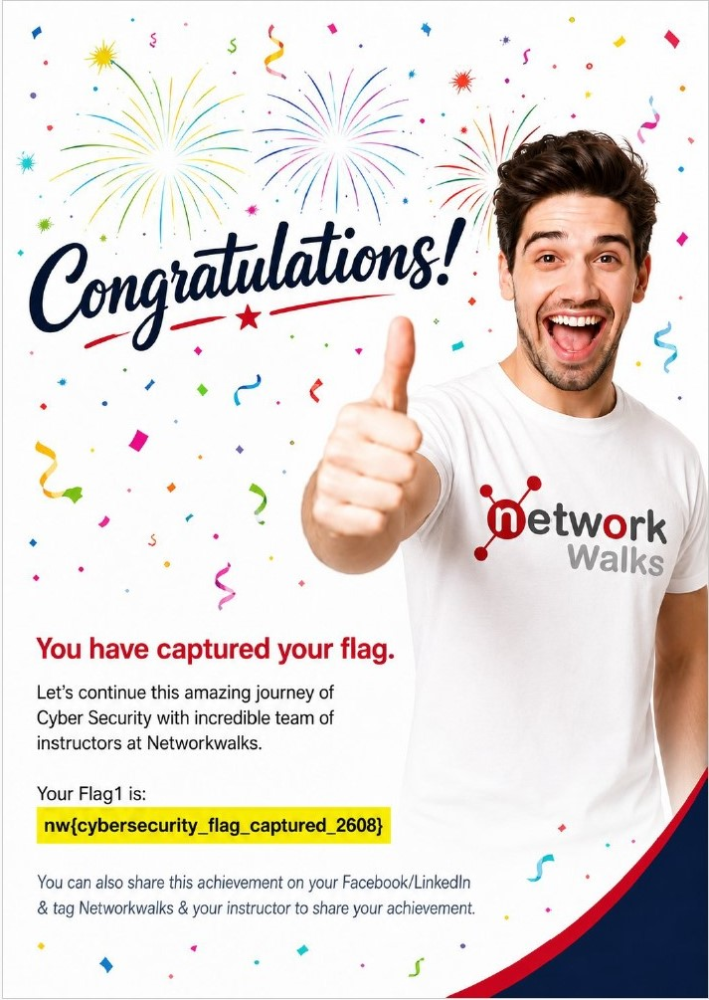

# PASSWORD RECOVERY WITH JTR AND NW FREE TOOLS REPORT
### Recovering passwords using JTR & NW free tools

**W3-PM-FINAL  |  CYBERSECURITY  |  NETWORKWALKS**

| Field | Detail |
|---|---|
| **Name (Cybersecurity Internse)** | **Edwin Selorm Azinogo** |
| **Program/Batch** | B084-Networkwalks |
| **Date** | 20 November 2026 |
| **Tools used** | W3-PM1 (Johnny The Ripper) W3-PM2 (Networkwalk free tools) |
| **Permission secured from client?** | Yes |

# 1. Liability Disclaimer

I have performed these activities only on the documents where I had secured written permission. All these materials are for education and research purpose only. Do not use anything from here to break the law. The instructor, the authors and Networkwalks are not responsible for what you do with this knowledge. Every action you take is your own responsibility. Misuse can lead to criminal charges, heavy fines, loss of your job and a permanent record. In most countries unauthorised access is a crime even when nothing is damaged.

# 2. Introduction

This report covers password recovery using John The Ripper(W3-PM1) and Networkwalks free tools (W3-PM2). Johnny The Ripper was used to open a password locked PDF file and Networkwalk free browser tool was also used to open the same locked pdf file, so together they show how to open locked pdf files or any document. It is the Week 3 part of my ongoing internship program at Networkwalks.

Firstly, I used a file conversion tool called OnlineHashCrack **(onlinehashcrack.com)** to extract hash for the encrypted file. The hash file is then opened in the JTR to unlock the password.
For the second method I used Networkwalk Hash calculator to extract the encrypted pdf file and Networkwalk browser password cracker tool to unlock the password.

# 3. Tools Used

The following tools were used to perform the task:
1. Johnny The Ripper CLI and GUI
2. File conversion tool (online hash crack)
3. Networkwalk hash calculator and password cracker tools

# 4. Purpose of the Project

The purpose of this project is to identify the strength of the password-protected or encrypted file obtained by permission.

# 5. Conclusion

During Week 3 of my Cybersecurity & Ethical Hacking internship, I completed practical activity covering password cracking with Johnny The Ripper and Networkwalk free online tools.

In the first method, I used Online Hash Crack which is an online browser tool to extract the encrypted pdf file I then used JTR both the CLI and GUI tools to unlock the password. 

In the second method, I used Networkwalk online browser tools like Hash calculator and password Cracker tools to unlock the encrypted file. I however encountered a challenge after loading the locked pdf file the access was denied. Additional wordist file was uploaded onto the hash calculator before it was able to open the password.

I learned how to crack password using the above two methods.

# 6. Documented Evidences

# 👤 Author

**Edwin Selorm Azinogo**
Aspiring Cybersecurity & Networking Professional
**Cyber security Interns B084**

GitHub: [EdwinAzinogo](https://github.com/EdwinAzinogo)  
LinkedIn: [EdwinAzinogo](https://www.linkedin.com/in/edwinazinogo)
